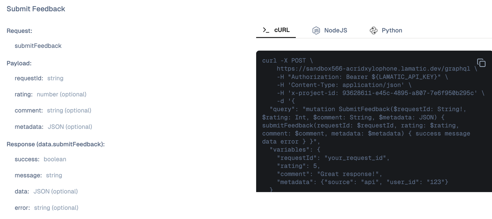

import { Callout, Tabs } from "nextra/components";

# Feedback API

The Feedback API allows you to collect user feedback from any flows, specifically GraphQL APIs. This enables you to gather ratings, comments, and metadata about API responses, which can be viewed in the Reports section to improve your AI applications.

## Overview

When executing flows via GraphQL API, you receive a `requestId` in the response. This `requestId` can be used to submit feedback about the flow execution, helping you track user satisfaction and identify areas for improvement.

## Getting the Request ID

After executing a flow via GraphQL API, you'll receive a `requestId` in the response. This unique identifier is used to associate feedback with a specific flow execution.

```json
{
  "data": {
    "executeWorkflow": {
      "requestId": "your_request_id",
      "status": "success",
      "result": { ... }
    }
  }
}
```

## Authentication

To submit feedback, you'll need to include your API key in the request headers:

```
Authorization: Bearer your_api_key
```

You'll also need to include your project ID:

```
x-project-id: your_project_id
```

> Click Here to know how to get your own [API Key](/docs/studio/Project/Settings/keys)

## Submit Feedback

The `submitFeedback` mutation allows you to submit feedback for one or more flow executions.

<Callout type="info">
  Existing projects get these fields after their next deployment. Redeploy any flow in your project to enable them.
</Callout>

### Request Parameters

| Parameter | Type | Required | Description |
| --- | --- | --- | --- |
| `requestId` | String | One of `requestId` / `requestIds` | The `requestId` returned by a flow execution. |
| `requestIds` | [String!] | One of `requestId` / `requestIds` | Up to 25 request IDs. The same feedback is attached to each one. Duplicates are ignored. |
| `rating` | Int | No | Whole-number rating. We recommend a 1–5 scale; values from 0 to 255 are accepted. |
| `weight` | Float | No | Number between 0 and 1 indicating how much this feedback should count (e.g. confidence or importance). |
| `comment` | String | No | Free-text feedback, up to 5,000 characters. |
| `metadata` | JSON | No | Any extra data as a JSON object (not an array or string). Max 16 KB, nesting depth up to 5, up to 100 keys in total. |

- Provide exactly one of `requestId` or `requestIds`. Sending both, or neither, returns an error.
- Include at least one of `rating`, `weight`, `comment` or `metadata`.
- Invalid input is rejected and nothing is stored. The `error` field lists every problem at once, separated by "; ".

### Response Fields

| Field | Type | Description |
| --- | --- | --- |
| `success` | Boolean | Indicates if the feedback was submitted successfully |
| `message` | String | A message describing the result |
| `data` | JSON | Contains `feedbackId` on every successful submission, plus `results` (a per-request outcome list) when `requestIds` is used |
| `error` | String | Error message if submission failed |

### Code Examples

<Tabs items={['cURL', 'NodeJS', 'Python']}>
  <Tabs.Tab>
    ```bash
    curl -X POST \
      https://sandbox566-acridxylophone.lamatic.dev/graphql \
      -H "Authorization: Bearer ${LAMATIC_API_KEY}" \
      -H 'Content-Type: application/json' \
      -H 'x-project-id: 93628611-e45c-4895-a807-7e6f950b295c' \
      -d '{
        "query": "mutation SubmitFeedback($requestId: String, $requestIds: [String!], $rating: Int, $weight: Float, $comment: String, $metadata: JSON) { submitFeedback(requestId: $requestId, requestIds: $requestIds, rating: $rating, weight: $weight, comment: $comment, metadata: $metadata) { success message data error } }",
        "variables": {
          "requestId": "your_request_id",
          "rating": 5,
          "weight": 0.8,
          "comment": "Great response!",
          "metadata": {
            "source": "api",
            "user_id": "123"
          }
        }
      }'
    ```
  </Tabs.Tab>
  <Tabs.Tab>
    ```javascript
    const axios = require('axios');

    // Export your Lamatic API key as an environment variable
    const lamatic_api_key = process.env.LAMATIC_API_KEY;

    const query = `
      mutation SubmitFeedback(
        $requestId: String
        $requestIds: [String!]
        $rating: Int
        $weight: Float
        $comment: String
        $metadata: JSON
      ) {
        submitFeedback(
          requestId: $requestId
          requestIds: $requestIds
          rating: $rating
          weight: $weight
          comment: $comment
          metadata: $metadata
        ) {
          success
          message
          data
          error
        }
      }
    `;

    const variables = {
      requestId: "your_request_id",
      rating: 5,
      weight: 0.8,
      comment: "Great response!",
      metadata: {
        source: "api",
        user_id: "123"
      }
    };

    const options = {
      method: 'POST',
      url: 'YOUR_PROJECT_ENDPOINT',
      headers: {
        Authorization: `Bearer ${lamatic_api_key}`,
        'Content-Type': 'application/json',
        'x-project-id': 'YOUR_PROJECT_ID',
      },
      data: { query, variables }
    };

    axios(options)
      .then(response => console.log(response.data))
      .catch(error => console.error(error));
    ```
  </Tabs.Tab>
  <Tabs.Tab>
    ```python
    import os
    import requests

    # Export your Lamatic API key as an environment variable
    lamatic_api_key = os.getenv('LAMATIC_API_KEY')

    gqlQuery = """
      mutation SubmitFeedback(
        $requestId: String
        $requestIds: [String!]
        $rating: Int
        $weight: Float
        $comment: String
        $metadata: JSON
      ) {
        submitFeedback(
          requestId: $requestId
          requestIds: $requestIds
          rating: $rating
          weight: $weight
          comment: $comment
          metadata: $metadata
        ) {
          success
          message
          data
          error
        }
      }
    """

    variables = {
      "requestId": "your_request_id",
      "rating": 5,
      "weight": 0.8,
      "comment": "Great response!",
      "metadata": {
        "source": "api",
        "user_id": "123"
      }
    }

    data = {"query": gqlQuery, "variables": variables}

    headers = {
      "Authorization": f"Bearer {lamatic_api_key}",
      "Content-Type": "application/json",
      "x-project-id": "YOUR_PROJECT_ID"
    }

    url = "YOUR_PROJECT_ENDPOINT"

    response = requests.post(url, headers=headers, json=data)

    if response.status_code == 200:
        print(response.json())
    else:
        print(f"Error: {response.status_code}")
        print(response.text)
    ```
  </Tabs.Tab>
</Tabs>

### Feedback for multiple requests

Use `requestIds` to give one piece of feedback to several requests that were made together. For example, two calls that together answered one user question.

```bash
curl -X POST \
  https://sandbox566-acridxylophone.lamatic.dev/graphql \
  -H "Authorization: Bearer ${LAMATIC_API_KEY}" \
  -H 'Content-Type: application/json' \
  -H 'x-project-id: 93628611-e45c-4895-a807-7e6f950b295c' \
  -d '{
    "query": "mutation SubmitFeedback($requestId: String, $requestIds: [String!], $rating: Int, $weight: Float, $comment: String, $metadata: JSON) { submitFeedback(requestId: $requestId, requestIds: $requestIds, rating: $rating, weight: $weight, comment: $comment, metadata: $metadata) { success message data error } }",
    "variables": {
      "requestIds": ["request_id_1", "request_id_2"],
      "rating": 4,
      "weight": 0.8,
      "comment": "Good together"
    }
  }'
```

The feedback is stored on each request, and all copies share one `feedbackId`. You can send up to 25 request IDs per call.

## Response Examples

### Success (single request)

```json
{
  "data": {
    "submitFeedback": {
      "success": true,
      "message": "Feedback submitted successfully",
      "data": {
        "feedbackId": "6f1c...-uuid",
        "requestId": "your_request_id",
        "rating": 5,
        "weight": 0.8,
        "comment": "Great response!",
        "timestamp": "2026-10-13T10:00:00.000Z"
      },
      "error": null
    }
  }
}
```

### Success (multiple requests)

```json
{
  "data": {
    "submitFeedback": {
      "success": true,
      "message": "Feedback submitted successfully",
      "data": {
        "feedbackId": "6f1c...-uuid",
        "requestIds": ["request_id_1", "request_id_2"],
        "rating": 4,
        "weight": 0.8,
        "comment": "Good together",
        "timestamp": "...",
        "results": [
          { "requestId": "request_id_1", "success": true },
          { "requestId": "request_id_2", "success": true }
        ]
      },
      "error": null
    }
  }
}
```

### Partial failure (multiple requests)

If feedback can't be stored for some of the requests, `success` is `false` and `message` reads, for example, "Feedback submitted for 1 of 2 requests". `data.results` marks each request with `success`, and with an `error` for the ones that failed. Feedback for the requests that succeeded is still stored.

### Validation error

```json
{
  "data": {
    "submitFeedback": {
      "success": false,
      "message": "Invalid feedback input",
      "data": null,
      "error": "rating must be an integer between 0 and 255; weight must be a number between 0 and 1"
    }
  }
}
```

## Viewing Feedback

After submitting feedback, you can view all collected feedback in the **Reports** section of your Lamatic dashboard. The reports provide insights into:

- User ratings and satisfaction levels
- Comments and textual feedback
- Metadata associated with feedback submissions
- Trends and patterns over time

<Callout type="info">
  Reports and the Logs view are based on ratings. Feedback submitted without a `rating` is stored but may not appear there.
</Callout>

This data helps you identify areas for improvement and track the quality of your AI applications.

