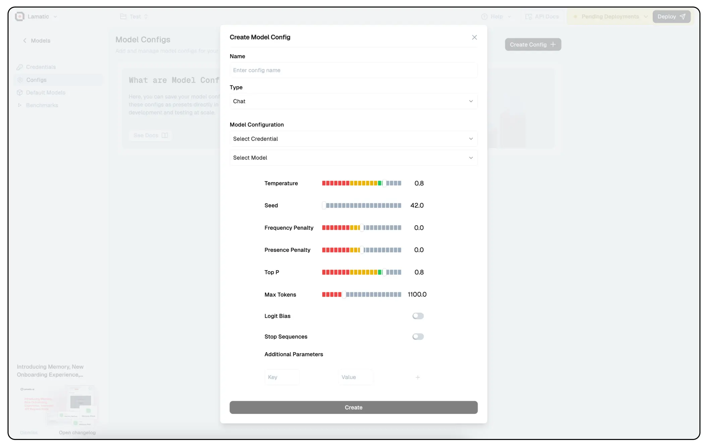

# Model Config

Model Config play a crucial role in fine-tuning the behavior of Large Language Models (LLMs). They help control aspects such as creativity, coherence, repetition, and response length, ensuring that the model generates outputs tailored to specific use cases. Properly configuring these parameters can significantly impact the quality and relevance of the generated text.

## 1. Temperature
- Controls the randomness of responses.
- **Higher values (e.g., 1.0-1.5)** → More creative and diverse responses.
- **Lower values (e.g., 0.2-0.5)** → More focused and deterministic outputs.

## 2. Seed
- Sets a fixed starting point for randomization, ensuring repeatability.
- If a specific seed is used, the model will generate the same output for the same prompt.

## 3. Frequency Penalty
- Discourages frequent word repetition.
- **Higher values (e.g., 1.0-2.0)** → Less repetition.
- **Lower values (e.g., 0-0.5)** → More repetition.

## 4. Presence Penalty
- Encourages or discourages introducing new words.
- **Higher values** → More variety in topics covered.
- **Lower values** → Tends to stick to common words.

## 5. Top P (Nucleus Sampling)
- Limits token selection to a subset of the most likely words.
- **Lower values (e.g., 0.1-0.5)** → More focused and deterministic.
- **Higher values (e.g., 0.8-1.0)** → More diverse and creative.

## 6. Logit Bias
- Adjusts the likelihood of specific words appearing.
- Can be used to make the model prefer or avoid specific words.

## 7. Stop Sequences
- Defines words/phrases where the response should stop.
- Useful for structured outputs like chatbots.

## 8. Max Tokens
- The maximum length of the generated response.
- Affects the response length.

## Additional Parameters
- Custom key-value pairs can be added for model-specific tuning.
- `prompt_caching` = `false` turns off prompt caching for Claude models. See [Prompt Caching (Claude)](#prompt-caching-claude).

## Prompt Caching (Claude)

Lamatic caches the system prompt of Claude models automatically, so repeated calls cost less and respond faster. This applies to Claude called through Anthropic, and to Claude 3.7 Sonnet and Claude 4 or newer on AWS Bedrock.

- **First call:** the system prompt is written to the cache. That part of the input costs about 25% more than normal.
- **Later calls within about 5 minutes:** if the system prompt is exactly the same, it is read back from the cache at about 10% of the normal input price.
- **Short system prompts:** the minimum applies to the cached part (the system prompt), not to the whole request. A system prompt below the model's minimum, which ranges from about 500 to 4,000 tokens depending on the model, isn't cached and costs the same as before, even if the user message is long.

The cache covers the system prompt at the start of the request, including any variables it contains. The user message and chat history are not cached.

You can see cache usage in a node's `_meta` output: `cache_creation_input_tokens` is the cache write, and `cache_read_input_tokens` is the cache read.

<Callout type="info">
To turn caching off for a model, add `prompt_caching` with the value `false` under **Additional Parameters**. Consider this when your system prompt changes on every call (for example, when it includes per-request variables), or when calls are more than 5 minutes apart. In those cases every call pays for a cache write that is never reused.
</Callout>

